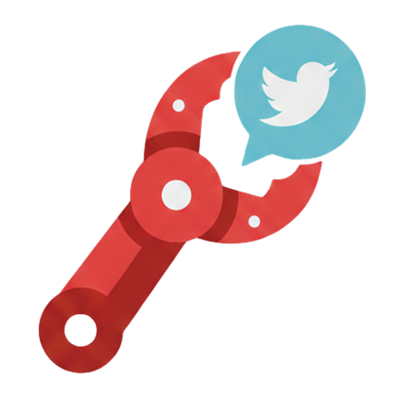

<p align="center">
  
</p>

# Claw Post MCP

Your AI agent becomes your social media brand ambassador. Not an API aggregator. Not a cloud VM browser.
Your agent calls our MCP, and your own logged-in desktop Chrome publishes. No platform API keys.

- **Homepage:** https://clawpost.net
- **Remote MCP:** `https://mcp.clawpost.net/mcp` (Streamable HTTP, OAuth)
- **Official MCP Registry:** `io.github.Daydreamnationtechlabs/clawpost`
- **Chrome extension:** [Install from Chrome Web Store](https://chromewebstore.google.com/detail/clawpost/gebmgifdmnflfcehpbepkdnndkhgkchh)
- **OpenClaw skill:** `openclaw skills install @daydreamnationtechlabs/clawpost`
- **FAQ / support:** https://clawpost.net/faq or mailto:leo@clawpost.net

**Platforms:** X, LinkedIn, Facebook (feed and groups), TikTok, Instagram, plus comments/replies on X, Facebook, LinkedIn, and Reddit. LinkedIn DMs. Reddit DMs are not supported.

## Setup

1. Sign up at https://clawpost.net
2. Install the Chrome extension, click its icon and sign in with Google (auto-pairs). Short video guides are built into setup.
3. Stay logged in to the social sites in that Chrome profile
4. Connect your MCP client and complete OAuth

### Claude Code

```bash
claude mcp add --transport http clawpost https://mcp.clawpost.net/mcp
```

### Cursor

Add to your MCP settings (`.cursor/mcp.json` or global settings):

```json
{
  "mcpServers": {
    "clawpost": {
      "type": "http",
      "url": "https://mcp.clawpost.net/mcp"
    }
  }
}
```

## Tools (17)

| Group | Tools |
| --- | --- |
| Post | `list_platforms`, `create_post`, `get_upload_url` |
| Comment/Reply | `create_reddit_comment`, `create_x_reply`, `create_linkedin_comment`, `create_facebook_comment`, `reply_to_comment` |
| DMs | `create_linkedin_message` (20/day) |
| Notifications | `check_notifications`, `list_replies`, `mark_reply_read` |
| Jobs | `get_post_status`, `cancel_post`, `submit_job_input` |
| Account | `get_account_status` |
| Groups | `join_facebook_group` (when the user asks, 5/day; do not auto-join) |

### Facebook threaded replies

If `targetUrl` includes `comment_id=`, `create_facebook_comment` / `reply_to_comment` posts a threaded reply under that parent (no top-level fallback).

### Notifications loop

1. `check_notifications`
2. `list_replies`
3. `reply_to_comment` (or the platform-specific tool)
4. `mark_reply_read`

## How it works

Your agent sends a job to our MCP. Our Chrome extension runs it inside your real desktop Chrome session. Your social logins never leave your browser, and nothing is shared with the model.

```
Agent  --MCP call-->  Claw Post Server  --job-->  Chrome Extension  --post-->  Social Platform
                            |
                      OAuth auth
```

## Security

- Your social credentials never leave your browser
- OAuth authentication for the MCP connection
- No platform API keys required or stored
- Report security issues to human@daydreamnation.io

## Vendor

Daydream Nation Tech Labs

## License

MIT License. See [LICENSE](LICENSE) for details.
